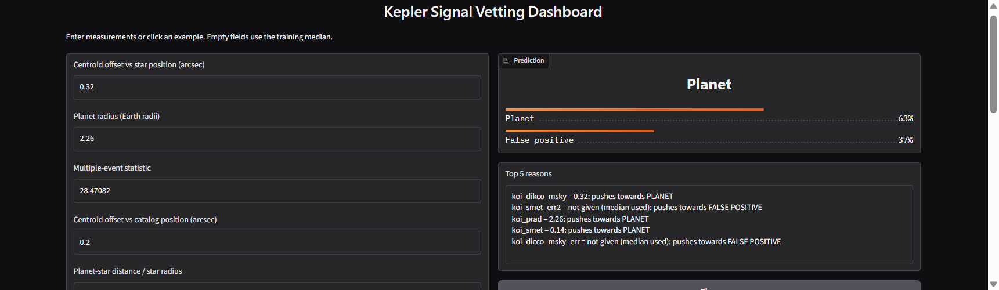

# Explainable Exoplanet Classification and Ranking System

**IT Workshop III - Course Project (Python)**
Name: Shaeel Santosh Hasepatil | Roll No.: 2025BCS0133

A machine-learning project on NASA's Kepler data. It tells real planets apart from false positives, ranks the signals that are still undecided, explains its decisions, saves predictions in a database and has a small web app.

This project builds on my earlier capstone: https://github.com/Shaeel-Hasepatil/exoplanet-disposition-classification

---

## What is in this repo

| File | What it is |
|---|---|
| `Capstone_Project_v2_(1).ipynb` | The full project notebook (code, outputs and explanations) |
| `Exoplanet_Vetting_Project_Report.pdf` | The project report |
| `app_files/` | The standalone Gradio app: `app.py`, the saved model (`vetting_model.joblib`), `config.json`, `requirements.txt` and a screenshot |
| `README.md` | This file |

---

## The problem

The Kepler telescope looked for small dips in a star's brightness, which can mean a planet passed in front of it. NASA labels each signal as **CONFIRMED** (planet), **FALSE POSITIVE** (not a planet) or **CANDIDATE** (not decided yet). Many false positives come from eclipsing binary stars or a nearby star mixing in its light. This project builds a model that vets these signals automatically.

## Dataset

NASA Exoplanet Archive, Kepler Objects of Interest (KOI) cumulative table: 9,564 signals and 155 columns. It is loaded in the notebook with `astroquery`, so no file download is needed.
https://exoplanetarchive.ipac.caltech.edu/

| Class | Count |
|---|---|
| FALSE POSITIVE | 4,839 |
| CONFIRMED | 2,748 |
| CANDIDATE | 1,977 |

---

## What I did

1. **Fixed the evaluation.** Used a scikit-learn `Pipeline` and `StratifiedGroupKFold` grouped by star, so no star appears in both train and test.
2. **Restored diagnostic features.** Added back centroid offsets, odd-even depth and event statistics (51 to 59 features) and measured the effect (ablation study).
3. **Built a vetting model.** CONFIRMED vs FALSE POSITIVE, comparing tuned Random Forest, Gradient Boosting and XGBoost with class-imbalance handling.
4. **Ranked the candidates.** The best model gives each of the 1,977 CANDIDATE signals a planet probability.
5. **Explained the model.** Permutation importance, SHAP, and a test of whether the error-bar columns act as a shortcut.
6. **Stored predictions in SQLite** and built a **Gradio app** to try new signals.

## Main results

| Step | Result |
|---|---|
| Honest baseline (grouped CV, base features) | macro F1 = 0.749 |
| After restoring diagnostic features | macro F1 = 0.805 |
| Vetting model (XGBoost, held-out test stars) | macro F1 = 0.973, ROC-AUC = 0.995 |
| Candidates with planet probability >= 0.9 | 487 of 1,977 |

Notes:
- The vetting model scores higher than the 3-class result because the hard CANDIDATE class is not part of it, so the two numbers should not be compared directly.
- Kepler's own labels were partly made with the same diagnostics, so the model is an automatic vetting aid, not an independent planet finder.
- The candidate ranking has no true labels to check against.

---

## How to run the notebook

1. Open the `.ipynb` file in **Google Colab** (upload it, or use the Colab link inside the notebook).
2. Click **Runtime**, then **Run all**. The first cells install `astroquery`, `xgboost`, `shap` and `gradio`.
3. An internet connection is needed to load the NASA data. The tuning cell (Section 16) can take a few minutes.

## The Gradio app

The app takes 10 measurements (the most important features) and shows the planet probability and the top 5 reasons from SHAP. It has three example rows to click. Each prediction is saved to SQLite.



GitHub cannot show a live Gradio app, and the share link printed in the notebook expires after about a week. To run the app yourself:

```
cd app_files
python -m venv venv
venv\Scripts\activate          (Windows)   or   source venv/bin/activate   (Mac/Linux)
pip install -r requirements.txt
python app.py
```

Then open http://127.0.0.1:7860 in a browser. Use the library versions in `requirements.txt`, because the saved model needs scikit-learn 1.6.1. You can also run Section 20 of the notebook in Colab.

Limitations of the app:
- The form only has 10 of the 59 features and the rest are filled with medians, so the app is only approximate (test macro F1 about 0.53 with 10 fields, compared with 0.973 using all 59 features). For example, the top-ranked candidate gets about 0.55 planet probability in the app. This is explained in the report.

## Tools

Python, pandas, NumPy, Matplotlib, Seaborn, scikit-learn, XGBoost, SHAP, SQLite (`sqlite3`), Gradio, astroquery.
